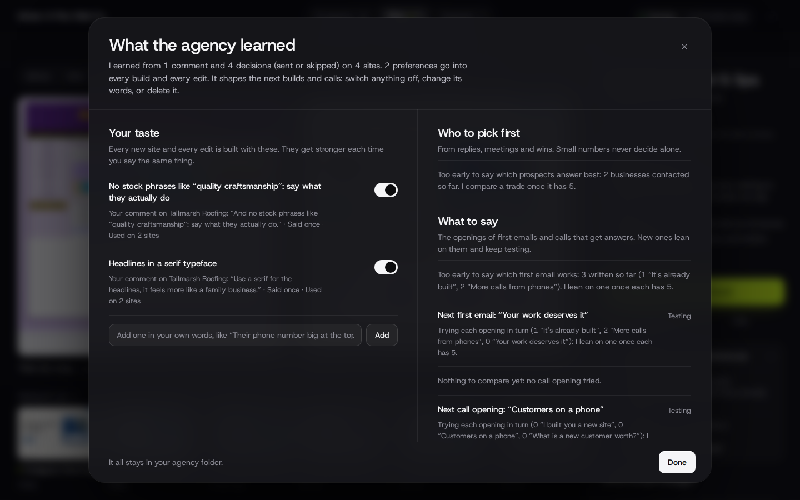
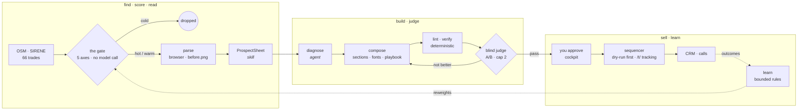

<p align="center">
  
</p>
<p align="center"><sub>Played by the real product on fictional businesses. Every name, town, phone number and photo in this repository is invented.</sub></p>

<h1 align="center">Last Web Studios</h1>

<p align="center"><b>A web agency kit that does the legwork and leaves the decisions to you. It finds local businesses with a dated website, rebuilds the site from their own content, has a second AI check (without knowing which is which) that the new one is really better, pitches with the finished result, and learns from every outcome. You approve every site and make every call.</b></p>

<p align="center">
  
  
  
  
  <a href="LICENSE"></a>
</p>

**What it takes, before you install anything.**

- **Building sites needs Claude**: a Claude Pro plan ($20 a month), a Max plan, or a Claude API key paid per use.
  ChatGPT alone can't build sites (it can run the lighter steps). The demo needs nothing at all.
- **A laptop and a Claude plan** get you: the demo, real sites built one at a time (10 to 14 minutes and about $3
  of plan quota each), a cockpit that finds prospects and keeps your call list with scripts, a public link to show a
  business owner their new site, and invoices. You approve every site and make every call; nothing runs while the
  cockpit is closed. This is what this edition is built for.
- **"Runs itself"** takes more: a small server that stays on, a Postgres database, your own domain and mailboxes
  warmed up for about two weeks, then two switches you set by hand before any real email goes out
  ([docs/GUIDE.md](docs/GUIDE.md)).
- **Your plan's terms**: Pro and Max are personal plans under
  [Anthropic's consumer terms](https://www.anthropic.com/legal/consumer-terms). We can't tell you that a given
  business use fits them; read them. For a team, client volume or anything unattended on a server, use an API key
  (commercial terms, billed per use, with a daily cap).

The demo *is* the pitch: instead of sending a proposal, the agency shows a site that already exists.

## Prerequisites

- **Node 20.12+** (24 recommended) and **git**, on macOS or Linux. On Windows, use WSL (the start scripts are
  bash).
- **A Claude subscription** (Pro or Max) with [Claude Code](https://claude.ai/code) installed and logged in
  (`claude auth login`), or an Anthropic API key: **building sites needs Claude Code**. A ChatGPT subscription
  alone can't build sites; it can only run the lighter steps (see
  [Run it on your subscription](#run-it-on-your-subscription)).
- **Chromium for Playwright** (`npx playwright install chromium`) to read sites and check builds. Not needed to
  look at the demo.
- Optional, later: [`cloudflared`](https://developers.cloudflare.com/cloudflare-one/connections/connect-networks/downloads/)
  to give a business owner a public link to their new site (`npm run share`); a Postgres database for the always-on
  agency; a domain and mailboxes for sending.

## Non-technical? Start here

You need a Claude subscription (Pro or Max) to build sites. The steps are terminal commands you copy and paste;
everything after them happens in your browser.

1. Install [Node.js](https://nodejs.org) (LTS) and [git](https://git-scm.com), then open a terminal (on Windows,
   install WSL first and run every command below inside it).
2. `git clone https://github.com/Sc4rville/lastwebstudios.git && cd lastwebstudios && npm ci`
3. `npm run sandbox` for the demo studio, an American one (Austin businesses, English, dollars), or
   `npm run sandbox -- --country FR` for the French one. It prints its address on the line that starts with
   `✓ Fictional agency ready`: open it in your browser. Nothing is sent, nothing costs anything. Click around:
   **Prospects → Sites → Outreach** is the whole product. `Ctrl-C` in the terminal stops it.
4. `npx playwright install chromium` (the browser that reads sites), then `npm run doctor`: one line per thing to
   install or log in to, with the exact command.
5. `npm run first-site -- --sample` builds a real site on a fictional business (an Austin pool builder until your
   agency is set, then one of your agency's country; 10–14 minutes, about $3 of plan usage, an estimate), then
   `npm run backoffice` opens your own cockpit.
6. Make it yours: in the cockpit, **⋯ › Settings** (your agency's name, your first name, country, the AI you use,
   your email and offer). The day-one walkthrough is [docs/GETTING-STARTED.md](docs/GETTING-STARTED.md); the words
   used here are in the [glossary](#glossary).

`CLAUDE.md` is for AI coding agents working in the repository, not for you.

## What it does

The loop has seven stages. Each one does one job and talks to the others only through files in `data/`, so any
stage can be replaced or re-run on its own.

- **Find.** Prospects come from OpenStreetMap (independent businesses with a website, chains excluded, any country
  or state) and, in France, the public company registry (SIRENE, the French business register), across 66 trades
  (30 of them with a design playbook)
  (from kitchens and pools to plumbers, electricians and roofers). No scraped directory, no purchased list.
- **Score.** A gate reads the raw HTML with no model call and rates five axes, need 30, leverage 25, value 20,
  reachability 15, expansion 10. Polished sites are dropped before anything expensive runs; a visual judge only
  looks at the sites the free probe would otherwise let through.
- **Read.** A real browser captures the current site, its photos, its menu and its text; a skill turns that into a
  structured `ProspectSheet`. Nothing is invented: no fake reviews, no fake customers, and with the image engine off
  (the default) only the prospect's own photos.
- **Build.** Claude Code agents diagnose the old site, then compose a bespoke one by combining real section
  skeletons from the catalog with a curated open font pair and the trade's playbook. Deterministic checks
  (`design/scripts/lint.mjs`, `design/verify/verify.cjs`) refuse em dashes, broken assets, overflow and clipped headings before any judge sees it.
- **Judge.** A neutral model compares old and new **blind**, in alternating A/B order, on full-page captures. The
  site passes only if it is clearly more beautiful; otherwise the composer gets one more round (cap 2). The three
  example sites shipped here passed on the first round.
- **Sell.** You approve in the cockpit (two clicks), the agency researches the account and writes the call script,
  and a sequencer runs a short, click-gated, dry-run-first mail funnel with self-hosted tracking and one-click
  unsubscribe. A reply is a Hot Lead in the CRM; a signature is a win.
- **Learn.** Every outcome (sent, reply, meeting, won, lost) feeds back into the scoring gate through bounded,
  small-sample-safe rules, so the gate gets a little better at picking the next prospect.

## Try it in 60 seconds

```bash
git clone https://github.com/Sc4rville/lastwebstudios.git && cd lastwebstudios
npm ci
npm run sandbox                     # the demo studio: American (Austin businesses, English, dollars)
# npm run sandbox -- --country FR   # the French demo studio (businesses near Lyon, French sites, euros)
```

No key, no account, no `.env`. The sandbox starts an embedded database, seeds a fictional agency with
businesses at every stage of the funnel, plays the story with the real processes (approvals, a test-mode email
sequence where every mail is an `.eml` file, a signed click, a one-click unsubscribe, a reply, a meeting, a
signature, a lost deal, a lead the emails are writing to, a learning run, a build, and a first search that adds three
more prospects: nine businesses and five sites in all), then prints the cockpit's address on a free local port: open
it in your browser. Nothing is sent, nothing leaves your machine, the usage meter stays at
$0.00, and what you change is thrown away when it stops. `npm run sandbox -- --check` does the same, verifies every
view and exits; it takes between 8 and 27 seconds.

## Your first site

```bash
npx playwright install chromium
npm run doctor                            # one line per check: "missing X ⇒ do Y", ends with the next command
npm run first-site -- --sample           # a fictional dated site, served locally (Austin until your agency is set)
```

`first-site` runs the whole chain on one prospect: score, parse, sheet, diagnose, compose, lint and verify, blind
judge, then a local re-check, and writes `first-site.json` next to the site in `output/sites/`. The `--sample`
cast (`pecanwood` for the US, `orvane`, `brisane`, `lumeo`, `quillanne` for France; alone, the one of your
agency's country, or `pecanwood` while you have no `agency.config.json`) means your first run never targets a real
business. On a Claude subscription, the three runs
recorded in [examples/](examples/) and the release check of this edition (a clean clone, empty environment) took
between 10 and 14 minutes and used what Claude Code estimates at 2.5 to 3.8 dollars of plan quota (an estimate of
the tokens used, not a bill; the API ways bill per use), with image and video generation off (the default). On a
Pro plan a build of that size can take a large part of one usage window (they reset every five hours), so count on
a few builds a day; Max runs more. All four runs passed the blind judge on the first round.

Then a real one:

```bash
npm run first-site -- https://a-dated-site.example --industry plumber   # a trade name, English or French
npm run backoffice                         # your cockpit on http://127.0.0.1:4000 (or the next free port, printed)
```

## Use it for real

What works where, honestly:

| you have | what works |
|---|---|
| a laptop, a Claude subscription | everything above: the demo, `first-site` on any URL, and your cockpit (`npm run backoffice`) with **Find prospects**, builds, approvals, the call list and the call panel. The cockpit keeps its own local database (`data/pglite`, nothing to install) and runs the jobs itself. |
| + a shared Postgres database (`DATABASE_URL`) | the CRM shared between machines, a remote worker that builds while your laptop is closed. Local one-liner: `docker run -d -e POSTGRES_PASSWORD=lws -p 5432:5432 postgres:17-alpine`, or a free Supabase project; then `npm run db:init`. |
| + a domain and warmed-up mailboxes | automated email sequences with self-hosted tracking and one-click unsubscribe. Not before you set the two switches (see [The cage](#the-cage)); until then every mail is a file. |
| + a small VPS | the always-on agency: it finds, builds and judges while you sleep. The step-by-step is [docs/GUIDE.md](docs/GUIDE.md). |

**Show a business owner their new site.** On a laptop, the sites you build live at
`http://127.0.0.1:4000/preview/<prospect>/<date>/index.html`, which only you can open. `npm run share` (it needs
[`cloudflared`](https://developers.cloudflare.com/cloudflare-one/connections/connect-networks/downloads/), free, no
account) starts your cockpit behind a password and opens a Cloudflare quick tunnel: it prints the public https link
of a built site (no password: send it to the owner, or open it on your phone during the call) and your cockpit's
link (with the password). The link lasts while that terminal stays open. For a link that lasts, copy the site's
folder (`output/sites/<prospect-id>/<date>-composer/`) to any static host (Netlify, Cloudflare Pages, Vercel), or run the
always-on agency, which serves them on your domain ([docs/GUIDE.md](docs/GUIDE.md) §9–10).

**ChatGPT for the lighter steps**: `npm i -g @openai/codex`, `codex login`, then `LWS_LLM=codex` in `.env` (or
pick it in the cockpit's Settings). Building the sites still needs Claude (a Claude plan or an API key): ChatGPT
alone can't build sites.

**Outside France**: pick your country and language in the cockpit's Settings (they are saved in
`agency.config.json`): US emails get a CAN-SPAM footer, phones and addresses take local formats, sites and scripts are
written in your language, invoices take your country's fields. No public company registry is wired outside France;
OpenStreetMap is.

## Run it on your subscription

Two engines, two switches. The **skills** (prospect sheet, visual gate, the savior mail, diagnoses) are single
structured calls and go through the way you pick with `LWS_LLM`. The **agents** (composer, coach, account
research, edits) run in Claude Code and use whatever your Claude Code uses: a subscription (recommended), an API
key, Bedrock, Vertex, Foundry, or a gateway through `ANTHROPIC_BASE_URL`.

| `LWS_LLM` | runs on | what you set |
|---|---|---|
| `claude-code` (default) | your Claude subscription, through `claude -p` | nothing; on a server, `claude setup-token` and `CLAUDE_CODE_OAUTH_TOKEN` |
| `codex` | your ChatGPT subscription, through the Codex CLI (`codex exec`, structured output) | `npm i -g @openai/codex`, `codex login`; `LWS_CODEX_BIN` if the binary is elsewhere |
| `anthropic` | the Claude API, billed per token | `ANTHROPIC_API_KEY` |
| `anthropic-compatible` | any Messages API: Ollama, LM Studio, llama.cpp, LiteLLM, a gateway | `ANTHROPIC_BASE_URL`, `ANTHROPIC_AUTH_TOKEN`, `LWS_MODEL` |
| `openai-compatible` | any Chat Completions API: OpenAI, OpenRouter, Groq, Together, vLLM | `OPENAI_BASE_URL`, `OPENAI_API_KEY`, `OPENAI_MODEL` |

Models are chosen by role (`smart`, `fast`, `judge`), never by hard-coded ID; `LWS_MODEL_<ROLE>` overrides any
of them. Skill calls on the subscription are pure: no tools, no MCP server, no user settings, so a call carries
about 0.9k tokens of context instead of 25k. A Claude Max plan runs the composer through Claude Code's Workflow
tool (agents in parallel); a Pro plan uses `--engine local`, the same prompts orchestrated in Node, one `claude -p`
per agent. The whole layer, with recipes for Ollama, OpenRouter and gateways, is in [docs/BYO-MODEL.md](docs/BYO-MODEL.md).

## The cockpit

One server, no framework, no build step, English UI, three steps left to right: **Prospects → Sites → Outreach**.
Every click does something you can see: the button spins, a job strip shows the progress, cards arrive live, a toast
confirms. The cockpit runs the jobs itself (one search and one build at a time) unless a 24/7 worker is alive; in
the sandbox the jobs are simulated, so the whole machine plays with no key.

- **Prospects**: one field, *"Tell the agency what you're after"* ("20 plumbers and roofers around Austin", "a mix
  of trades near Lyon", "surprise me"). The agency shows what it understood as chips (removable), says back the
  words it didn't catch, and says when a town is in another country than your agency's (Austin is in the US, Nice
  in France). Prospects then arrive one by one (while your mouse is over the list, new ones wait behind a
  "N new prospects · Show" button, so nothing moves under your click): the business, its current site, why it was
  picked in plain words, "Strong fit" when its site has the most to gain, and its furthest step (waiting for you,
  in outreach, won, lost). Each business is a large capture of its site today (its new site once built, the build's
  progress drawn on the card while it runs), under a headline that says how many could use a new site and how the
  agency picks them. Under the field, what the search brought ("Found 12 of 20 plumbers near Austin: …").
  **Build site** / **Skip** (with Undo), one by one or in bulk. **Hands-off** (in the menu):
  new good prospects of your country that someone can contact get built without asking you, up to a daily cap in
  builds it asks for first; turning it on says how many already wait, how many are built today and how many
  tomorrow (first in line), turning it off cancels the queued builds. You still approve each site.
- **Sites**: the new sites in a filmstrip (waiting for you, in outreach, clients, skipped), Before / After / Compare
  (two framed pages at the same width, scrolling together), Desktop (laid out at 1440 and scaled) / Phone (a
  handset), why it's on your list in sentences, the old site one click away. **Send to outreach**, **Rebuild** (it
  asks what should be different), **Skip** (with Undo), "Built with 3 of your preferences" (which ones), and a
  feedback box ("tell the agency what to change"): your comment and the agency's answer read as an exchange, "Got it,
  changing it on this site. I'll remember: …" with an **Undo**. One job per site at a time: a site being built or edited can't be paid for twice. A site already
  in outreach, won or lost says so and links there. In the demo, a built site says it is a stand-in and links to a
  real build.
- **Outreach**: who to call, grouped by step with a step picker (Lost is one of them), each lead with its new site,
  **Next step →** on each card, keyboard-friendly, and on a wide screen the next call (who, why now, their new site
  large, one button). The call panel: click-to-call, the script in the language it is said in (its opening the one
  the agency is testing or leaning on) with your own instructions in English, the new site with Before / After and
  Copy link, what's worth knowing, the emails, a note, No answer, Meeting (two slots and Pick a day), Next step, Won,
  Lost; Lost always asks first, Won asks when there was no meeting; meeting times on your agency's clock; and a prompt: *ask for a follow-up email or a call angle* (never an
  email to someone who unsubscribed or has no address: a call angle instead; the demo's answers say they are the
  demo's). A business with no phone and no email says so. A lost lead leaves the board, behind "N lost", and can come
  back. What happens after approval (emails in test mode, your own tool, or your call list) sits at the top. A lead the
  emails are writing to sits in **Emails**: its card says how many were written, its Email tab shows each one in full
  (subject, body, legal footer) and when the next one goes, inside your sending hours (Monday to Friday, 9 to 5 on
  your agency's clock; `mail.sendHours` in `agency.config.json`). A click, a reply or the end of the emails puts it
  on the call list; a meeting, a win, a loss or a skipped site stops the emails, and the card says why. A business
  in the emails is "In outreach" in Prospects, never offered for a new build.

**Settings** (a line under the header says when the agency is still the demo one): your agency's name, your first
name, the one paragraph used in the emails and the scripts, which AI you use (and what each choice can and can't
do, with its status), your contact details and offer, how approvals work; it lists what still belongs to the demo
studio (and which addresses are `.example` placeholders). Switching the country swaps the demo studio's text for the
other demo's; emptying a field empties it. Your own cockpit says on its main screen when Claude isn't signed in.
**What the agency learned** (in the menu, and one click from a site and from a call): your taste, the preferences your
feedback became, each with where it came from, how often you said it, the sites it was used on, an on / off switch,
your own words and delete; who to pick first and what to say, in sentences with their sample sizes ("too early to
say" under 5). The status pill says the agency is running; its sheet says today's builds against the daily cap
("2 of 6 builds") and the plan usage they stand for (about $3 a build, an estimate, not a charge); **Stop** ends the
running build after the site it is on and nothing new starts. **Billing** (same header, same menu) issues invoices
and credit notes with the fields of your country (entity type, EIN and how to pay for a US studio, SIRET / VAT /
IBAN for a French one); no invoice gets a number before **Your business** has a name and an address (and a SIRET
in France) that are your own (in the sandbox, the demo studio's fictional details print a whole demo invoice), a
SIRET, an IBAN, an EIN or a payment link that can't be right is refused when you save it, an issue date in the
future is refused, a zero or absurd total is refused, an invoice has one credit note at most, and only the last draft can be
deleted.

The chrome follows your agency's country (`agency.config.json`): phone formats, "City, ST ZIP", 12-hour call
slots, the currency on invoices.

<p align="center">
  
</p>
<p align="center">
  
</p>
<p align="center">
  
  
</p>
<p align="center">
  
  
</p>

### It learns from you

Tell it what you think of a site, in your own words, in the box under the preview: "Use a serif for the headlines",
"no stock phrases like *quality craftsmanship*". It answers "Got it, changing it on this site. I'll remember: …"
(with an Undo), changes that site, and every next build and edit is made with that preference. Each site then says
which preferences it was built with ("Built with 2 of your preferences"), and one the demo can't show (their own
photo: a fictional business has none) is said as such, never claimed. The sites you send to outreach or skip, and
the replies, meetings and wins that follow, teach it who to pick first and which first email or call opening gets
answers, in sentences with their sample size ("too early to say" under 5). It all sits in one place, **What the
agency learned** (in the menu, and one click from a site): each preference with where it came from, an on / off
switch, your own words, and delete. Plain sentences, nothing about weights or models, and it stays in your agency
folder (`data/learning/`).

<p align="center">
  
</p>

## How it works



A **skill** costs a model call and lives in `.claude/skills/<name>/`; a **script** is deterministic and lives in
`<block>/scripts/`. One orchestrator (`architecture/`) owns the order. The contract between blocks is
[`packages/shared/prospect.ts`](packages/shared/prospect.ts). The worker (`worker/`) is the daemon that builds
while you are away: it claims a batch from the database, runs the composer, lets a coach check the served render on
desktop and mobile, and re-indexes the cockpit. On a laptop the cockpit runs those jobs itself. More in [docs/ARCHITECTURE.md](docs/ARCHITECTURE.md) and
[docs/DESIGN-ENGINE.md](docs/DESIGN-ENGINE.md).

## The cage

What keeps a machine that spends money and writes to strangers from doing damage when nobody is watching.

| guard | what it does |
|---|---|
| **STOP** | a `STOP` file at the root, or the button in the cockpit. The worker kills the running agent and exits, the sequencer and the warmup skip their tick, every scheduled job is skipped, the media boost spends nothing. Re-armed by a human (`npm run cage -- resume`). |
| **daily cap** | `LWS_BUILDS_PER_DAY` caps the sites built per UTC day (`data/logs/builds.jsonl`); absent, it is derived from `LWS_BUDGET_USD_DAY` ÷ the estimate of one build (`LWS_SITE_USD`, $3 by default). Reached: no new build until midnight UTC, in the worker and in the cockpit alike; a job past it keeps what fits and the rest waits for tomorrow. Absent both: no cap, which is why Hands-off asks for one (in builds) before it turns on. |
| **budget** | `LWS_BUDGET_USD_DAY` caps plan usage per UTC day across agents, skills, images and videos (`data/logs/spend.jsonl`, Claude Code's estimate on a subscription, not a charge); every agent gets a `--max-budget-usd`. Reached: no new job until midnight UTC. |
| **breaker** | bounces over 1 %, complaints over 0.1 % or unsubscribes over 2 % on a 7-day window (100-send floor) open the breaker: no mail leaves until a human re-arms it. |
| **two switches** | a real send needs `"dryRun": false` in `outreach/sequencer/config.json` **and** `LWS_LIVE_SEND=1`. One alone is refused. Until then every mail is written as an `.eml` in `data/sequencer/outbox/`, headers included. |
| **opt-out is final** | an unsubscribe or a complaint can never be re-enrolled, even with `--force`; a bounce blocks until the address changes; a tick ignores events from the future of its own clock, and a second tick waits for the lock instead of double-sending. |

`npm run cage` prints the state; the status pill in the cockpit's header shows it live.

## Going 24/7

The same repository runs unattended on a small VPS: systemd user units for the worker, the cockpit, the nightly
batch, the weekly scrape, the learning run, the warmup and the sequencer, installed by
`architecture/scheduling/install-units.sh --enable core` (then `auto`, `warmup`, `outreach` when you are ready).
Every job goes through `run-guarded.sh`: a lock, the cage check, a machine-readable state the cockpit reads, and a
dead-man's-switch alert on failure. The step-by-step, from an empty Ubuntu box to live sending, including the
hardening of the units and the order warmup then sequencer, is [docs/GUIDE.md](docs/GUIDE.md).

## Conformity and ethics

This is B2B cold outreach, and the code takes the rules seriously (French law by default; CAN-SPAM and CASL
footers when `country` is `US` or `CA`).

- **Legal basis and information.** The legitimate-interest assessment the French regulator (CNIL) asks for first
  is shipped ([docs/mailing-lia.md](docs/mailing-lia.md)); every mail carries the legal footer, the origin of the
  data (GDPR art. 14) and a one-click opt-out. B2B opt-out prospection under French e-commerce law (LCEN) applies
  to the recipient's profession only; the lead sources are business registries and listings, never private
  individuals.
- **One-click unsubscribe, for real.** `List-Unsubscribe` and `List-Unsubscribe-Post` headers (RFC 8058), the
  native Gmail and Yahoo button, a confirmation page for the link in the footer, and a reply saying STOP all work.
- **Nothing fake.** No fake reviews, no fake customers, no invented claims about a named competitor: the only
  sentence the draft can say about a competitor comes from `agency.config.json › outreach.competitorClaims`, which
  ships empty. The fake-persona complaint mails the team once tried are not part of this edition.
- **Opt-in for the gray zones.** Search-engine lookups to find a company's website are off by default
  (`agency.config.json › leadengine.searchFallback`), and the SMTP `RCPT TO` mailbox verifier is a separate command
  you run on purpose; both are documented as decisions you take knowingly.
- **A human sends.** The product never sends a mail unless a human sets the two switches, and it never contacts
  anyone outside the sequencer: drafts for the human-sent channel are Gmail drafts, never sent by code.

## What stays private

The team's private build goes further than this repository, and some of it cannot be published:

- real prospects, clients, sites and conversations;
- the harvested commercial fonts and the ten captured reference sites of the private design library, which is why
  the "template-fill" build path is not in this edition: the composer, with the OFL font library, is the only
  build path here;
- the fake-persona "complaint" mails, retired from the funnel, and the Higgsfield web-UI automation (the
  Higgsfield API path for hero videos stays, optional);
- the cyber-audit tool, the standalone call-center analytics, and the team's internal process skills.

Everything else, including the production prompts, the cockpit, the sequencer, the cage and the test harness, is
here.

## Project structure

```
architecture/    orchestration/ (compose-batch.workflow.js · workflow-local.ts · run.ts) · scheduling/ (units, install-units.sh, run-guarded.sh)
leadengine/      1_scraping (OSM · SIRENE · enrich) · 2_scoring (the gate, 5 axes, visual gate) · 3_parsing (parse · structure · audit)
design/          sections/ (21 skeletons) · industries/ (30 trade playbooks; RADAR.md ranks the 66 trades, in French) · fonts/ (31 OFL families, 14 pairs) · palettes/ · motion/ · scripts/lint.mjs
outreach/        sequencer · warmup · savior mail · tracking/ (/t/ signed links, RFC 8058) · contacts · drafts
learning/        outcomes → rules.json, read by the scoring (bounded ±15 per trade)
backoffice/      reviewpipe/ (the cockpit: server, pages, built-in job engine) · telegram/ (optional bot)
worker/          the daemon: composer · edit · research jobs, the coach, the image and video engines
packages/        shared/ (prospect.ts, cage, breaker, db, agency) · llm/ (ways, models by role, adapters) · utils/
scripts/         doctor · first-site · sandbox · cage · batch · oss/scan.mjs
db/              schema.sql (12 tables) · init.ts (idempotent, upgrades an older database)
.claude/skills/  composer · diagnose · beauty-gate · asset-boost · structuration · visual-scoring-gate · account-research · …
data/sample/     the fictional cast    examples/  three real builds    test/  the harness (unit · pg · e2e)
```

`agency.config.json` holds your agency's identity (name, country, language, sender, legal footer, the HELO name
your mail server announces, user agent, invoices, CRM operators). It is not shipped: the cockpit's Settings creates
it on your first save, and `.gitignore` keeps it out of your commits. Until then everything runs on the fictional
US studio of `agency.config.example.us.json` (the French one is `agency.config.example.json`), and `npm run doctor` says so. `.env.example` documents every variable, all optional, all commented
out; [docs/CONFIGURATION.md](docs/CONFIGURATION.md) is the reference.

## Glossary

- **Prospect**: a local business the agency found, with a dated website. **Strong fit**: its site has the most to
  gain from a rebuild.
- **The gate**: the free first check of a prospect's site (no model call), scoring five things: how much the site
  needs a rebuild, how much a better one would change for them, what the business is worth, how reachable they are,
  and how much more they could buy.
- **Skill** and **agent**: a skill is one structured model call (the prospect sheet, a diagnosis, the sales email);
  an agent is Claude Code working on its own with tools (composing a site, checking it, editing it).
- **Prospect sheet** (`ProspectSheet` in the code): what the agency knows about a business, read from its site.
- **Savior mail**: the first email, "here is your new site, already built". **Coach**: an agent that checks the
  served site on desktop and mobile. **Asset boost**: optional generated images or videos (off by default).
- **Workflow tool** / `--engine local`: on a Max plan the composer runs agents in parallel; on Pro, one at a time.
- **Test mode** (dry-run): every email is written as a file, none is sent. **The two switches**: what turns real
  sending on, on purpose (see [The cage](#the-cage)). **Warmed-up mailboxes**: new mailboxes that sent a little for
  two weeks so their emails are not taken for spam.
- **Hot lead**: a prospect who replied or clicked: call them. **Nurturing**: light emails for two months, no cold
  call. **Lost**: they said no; off the board.
- **Dead-man's switch**: an alert when a scheduled job stops reporting.

## Verify

```bash
npm run typecheck && npm test            # unit + integration, offline, fake claude, throwaway workspace
npm run test:pg                          # against a throwaway Postgres (Docker)
npm run test:e2e                         # the cockpit in a headless browser, 1440 and 390 px (Docker + Chromium)
node scripts/oss/scan.mjs .              # nothing real in the tree
```

The same checks run in CI on every push and pull request (`.github/workflows/ci.yml`), plus gitleaks.

## Contributing, security, license

- [CONTRIBUTING.md](CONTRIBUTING.md): setup, tests, how the code is organized, fictional data only.
- [SECURITY.md](SECURITY.md): private vulnerability reporting, what the product guarantees.
- [MIT](LICENSE) © 2026 Scarville. Third-party material is listed in [NOTICE](NOTICE).

## Credits

Built by **Scarville** ([@Sc4rville](https://github.com/Sc4rville)) and **Koussaïla**
([@kabylesystem](https://github.com/kabylesystem)), co-founders of LastWebStudios. Koussaïla leads the technology
on the lead-engine side: sourcing, scoring and prospect data.

All businesses in `data/sample/`, `examples/` and `test/fixtures/` are fictional. Fonts are © their authors under
the SIL Open Font License 1.1 (`design/fonts/<family>/OFL.txt`).
