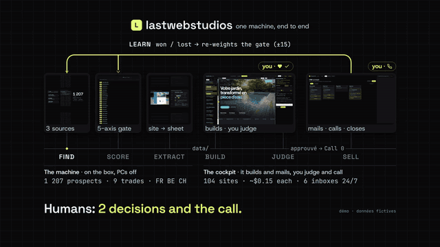
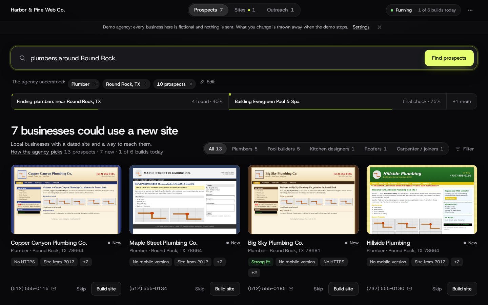
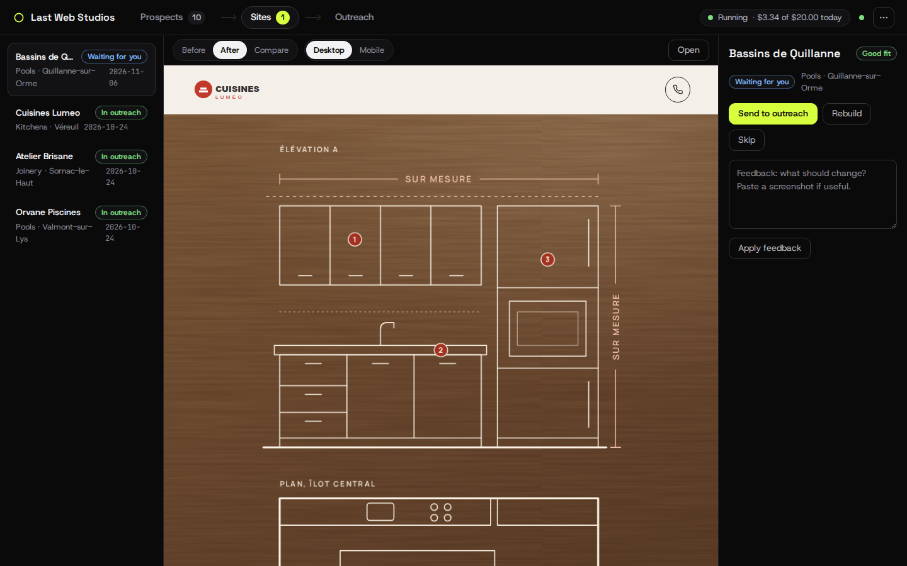
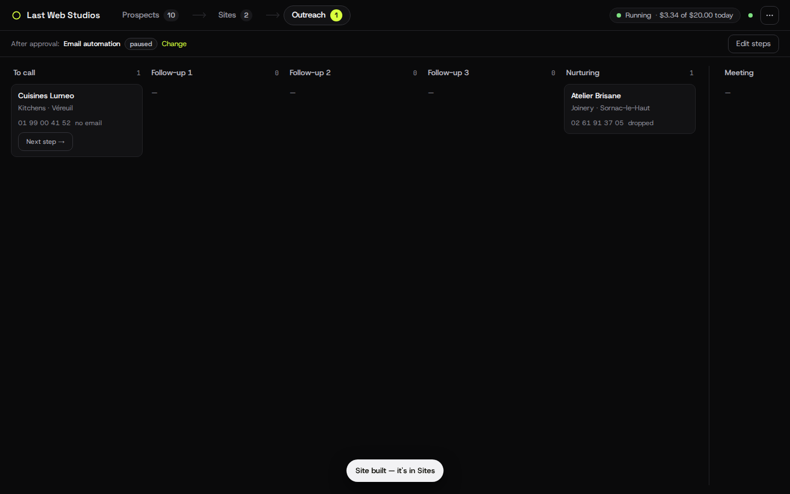
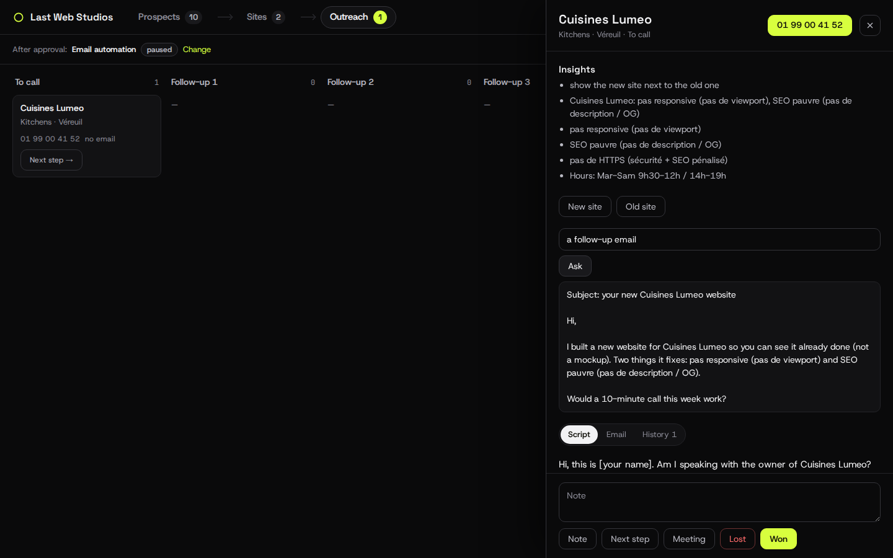
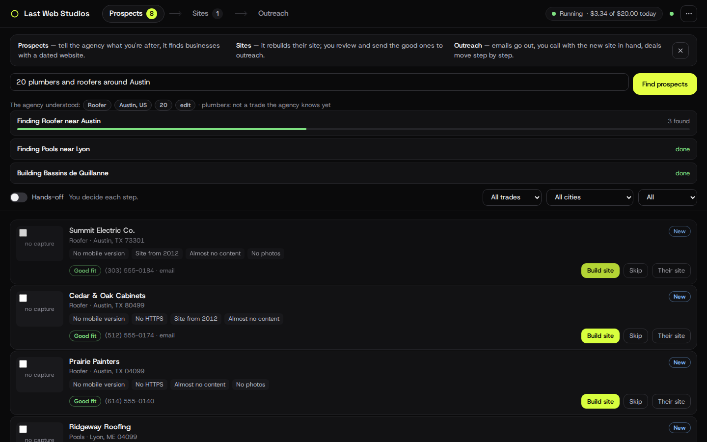
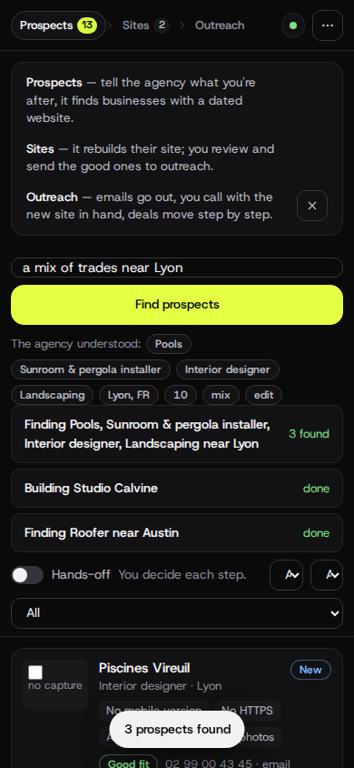
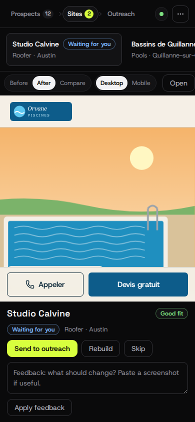
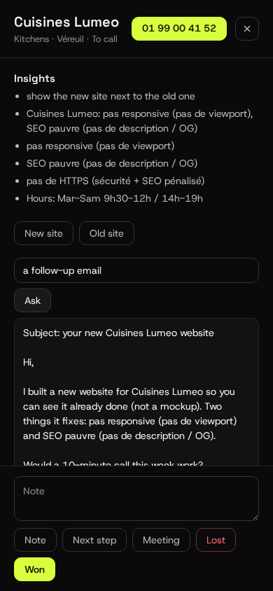

<p align="center">
  
</p>
<p align="center"><sub>Played by the real product on fictional businesses. Every name, town, phone number and photo in this repository is invented.</sub></p>

<h1 align="center">Last Web Studios</h1>

<p align="center"><b>A web agency that runs itself. It finds local businesses with a dated website, rebuilds the site from their own content, lets a blind judge decide whether the new one is really better, pitches with the finished result, and learns from every outcome.</b></p>

<p align="center">
  
  
  
  
  <a href="LICENSE"></a>
</p>

Bring your subscription, not a credit card. The product runs on the Claude subscription you already pay for,
through Claude Code. API keys, a ChatGPT subscription through the Codex CLI, a local model through Ollama, or any
OpenAI-compatible endpoint are options, not requirements. The demo *is* the pitch: instead of sending a proposal,
the agency sends a site that already exists.

## What it does

The loop has seven stages. Each one does one job and talks to the others only through files in `data/`, so any
stage can be replaced or re-run on its own.

- **Find.** Prospects come from OpenStreetMap (independent businesses with a website, chains excluded, any country
  or state) and, in France, the public company registry (SIRENE), across 56 trades. No scraped directory, no
  purchased list.
- **Score.** A gate reads the raw HTML with no model call and rates five axes, need 30, leverage 25, value 20,
  reachability 15, expansion 10. Polished sites are dropped before anything expensive runs; a visual judge only
  looks at the sites the free probe would otherwise let through.
- **Read.** A real browser captures the current site, its photos, its menu and its text; a skill turns that into a
  structured `ProspectSheet`. Nothing is invented: no fake reviews, no fake customers, and with the image engine off
  (the default) only the prospect's own photos.
- **Build.** Claude Code agents diagnose the old site, then compose a bespoke one by combining real section
  skeletons from the catalog with a curated open font pair and the trade's playbook. Deterministic checks
  (`design/scripts/lint.mjs`, `design/verify/verify.cjs`) refuse em dashes, broken assets, overflow and clipped headings before any judge sees it.
- **Judge.** A neutral model compares old and new **blind**, in alternating A/B order, on full-page captures. The
  site passes only if it is clearly more beautiful; otherwise the composer gets one more round (cap 2). The three
  example sites shipped here passed on the first round.
- **Sell.** You approve in the cockpit (two clicks), the agency researches the account and writes the call script,
  and a sequencer runs a short, click-gated, dry-run-first mail funnel with self-hosted tracking and one-click
  unsubscribe. A reply is a Hot Lead in the CRM; a signature is a win.
- **Learn.** Every outcome (sent, reply, meeting, won, lost) feeds back into the scoring gate through bounded,
  small-sample-safe rules, so the gate gets a little better at picking the next prospect.

## Try it in 60 seconds

```bash
git clone https://github.com/Sc4rville/lastwebstudios.git && cd lastwebstudios
npm ci
npm run sandbox
```

No key, no account, no `.env`. `npm run sandbox` starts an embedded Postgres (PGlite), loads the schema, seeds a
fictional agency with eight prospects at every stage of the funnel, plays the story with the real processes
(approvals, a dry-run sequence where every mail is an `.eml`, a signed click, a one-click unsubscribe, a reply, a
meeting, a signature, a lost deal, a learning run) and opens the cockpit on a free local port. Nothing is sent,
nothing leaves your machine. `npm run sandbox -- --check` does the same, verifies every view and exits; it takes
between 8 and 27 seconds.

## Your first site

```bash
npx playwright install chromium
npm run doctor -- --for first-site        # one line per check: "missing X ⇒ do Y"
npm run first-site -- --sample orvane     # a fictional dated site, served locally for the run
```

`first-site` runs the whole chain on one prospect: score, parse, sheet, diagnose, compose, lint and verify, blind
judge, then a local re-check, and writes `first-site.json` next to the site in `output/sites/`. The `--sample`
cast (`orvane`, `brisane`, `lumeo`, `quillanne`) means your first run never targets a real business. On a Claude
subscription, the three runs recorded in [examples/](examples/) and the release check of this edition (a clean
clone, empty environment) took between 10 and 14 minutes and cost between 2.5 and 3.8 dollars of plan quota as
estimated by Claude Code, with image and video generation off (the default). All four passed the blind judge on
the first round.

Then a real one:

```bash
npm run first-site -- https://a-dated-site.example --industry menuisier
npm run backoffice                         # http://127.0.0.1:4000 — before/after, comments, approval
```

## Run it on your subscription

Two engines, two switches. The **skills** (prospect sheet, visual gate, the savior mail, diagnoses) are single
structured calls and go through the way you pick with `LWS_LLM`. The **agents** (composer, coach, account
research, edits) run in Claude Code and use whatever your Claude Code uses: a subscription (recommended), an API
key, Bedrock, Vertex, Foundry, or a gateway through `ANTHROPIC_BASE_URL`.

| `LWS_LLM` | runs on | what you set |
|---|---|---|
| `claude-code` (default) | your Claude subscription, through `claude -p` | nothing; on a server, `claude setup-token` and `CLAUDE_CODE_OAUTH_TOKEN` |
| `codex` | your ChatGPT subscription, through the Codex CLI (`codex exec`, structured output) | `codex login`; `LWS_CODEX_BIN` if the binary is elsewhere |
| `anthropic` | the Claude API, billed per token | `ANTHROPIC_API_KEY` |
| `anthropic-compatible` | any Messages API: Ollama, LM Studio, llama.cpp, LiteLLM, a gateway | `ANTHROPIC_BASE_URL`, `ANTHROPIC_AUTH_TOKEN`, `LWS_MODEL` |
| `openai-compatible` | any Chat Completions API: OpenAI, OpenRouter, Groq, Together, vLLM | `OPENAI_BASE_URL`, `OPENAI_API_KEY`, `OPENAI_MODEL` |

Models are chosen by role (`smart`, `fast`, `judge`), never by hard-coded ID; `LWS_MODEL_<ROLE>` overrides any
of them. Skill calls on the subscription are pure: no tools, no MCP server, no user settings, so a call carries
about 0.9k tokens of context instead of 25k. A Claude Max plan runs the composer through Claude Code's Workflow
tool (agents in parallel); a Pro plan uses `--engine local`, the same prompts orchestrated in Node, one `claude -p`
per agent. The whole layer, with recipes for Ollama, OpenRouter and gateways, is in [docs/BYO-MODEL.md](docs/BYO-MODEL.md).

## The cockpit

One server, no framework, no build step, English UI, three steps left to right: **Prospects → Sites → Outreach**.
Every click does something you can see: the button spins, a job row shows the progress, cards arrive live, a toast
confirms. The cockpit runs the jobs itself (one at a time) unless a 24/7 worker is alive; in the sandbox the jobs
are simulated, so the whole machine plays with no key.

- **Prospects**: one field, *"Tell the agency what you're after"* ("20 plumbers and roofers around Austin", "a mix
  of trades near Lyon", "surprise me"). The agency shows what it understood as chips (editable), then prospects
  arrive one by one: the business, its current site, why it was picked in plain words, a "Good fit" chip.
  **Build site** / **Skip**, one by one or in bulk. **Hands-off**: new good prospects get built without asking
  you; you still approve each site.
- **Sites**: the built sites, Before / After / Compare, Desktop / Mobile. **Send to outreach**, **Feedback**
  ("tell the agent what to change", applied as a job), **Rebuild**, **Skip**.
- **Outreach**: the sales steps as a kanban, **Next step →** on each card, the call panel (click-to-call, the
  insights, the script, the email tab, Note · Meeting · Lost · Won) and a prompt: *ask for a follow-up email or a
  call angle*. What happens after approval (email automation, your own agent, or you) sits at the top; in Settings
  you describe your agency in one paragraph, used in the emails and the scripts.

The chrome follows your agency's country (`agency.config.json`): phone formats, "City, ST ZIP", 12-hour call
slots, the currency on invoices. One pill in the header says whether the agency is running and what it spent today.

<p align="center">
  
</p>
<p align="center">
  
</p>
<p align="center">
  
  
</p>
<p align="center">
  
</p>
<p align="center">
  
  
  
</p>

Works in France out of the box (SIRENE registry, LCEN footer). Any country with OpenStreetMap coverage works with
`country` and `language` set in `agency.config.json` (a fictional US studio is shipped as
`agency.config.example.us.json`): US footers follow CAN-SPAM, generated sites, mails and call scripts are written in
your language. No public company registry is wired outside France.

## How it works


A **skill** costs a model call and lives in `.claude/skills/<name>/`; a **script** is deterministic and lives in
`<block>/scripts/`. One orchestrator (`architecture/`) owns the order. The contract between blocks is
[`packages/shared/prospect.ts`](packages/shared/prospect.ts). The worker (`worker/`) is the daemon that builds
while you are away: it claims a batch from the database, runs the composer, lets a coach check the served render on
desktop and mobile, and re-indexes the Station. More in [docs/ARCHITECTURE.md](docs/ARCHITECTURE.md) and
[docs/DESIGN-ENGINE.md](docs/DESIGN-ENGINE.md).

## The cage

What keeps a machine that spends money and writes to strangers from doing damage when nobody is watching.

| guard | what it does |
|---|---|
| **STOP** | a `STOP` file at the root, or the button in the cockpit. The worker kills the running agent and exits, the sequencer and the warmup skip their tick, every scheduled job is skipped, the media boost spends nothing. Re-armed by a human (`npm run cage -- resume`). |
| **budget** | `LWS_BUDGET_USD_DAY` caps spending per UTC day across agents, skills, images and videos (`data/logs/spend.jsonl`); every agent gets a `--max-budget-usd`. Reached: no new job until midnight UTC. |
| **breaker** | bounces over 1 %, complaints over 0.1 % or unsubscribes over 2 % on a 7-day window (100-send floor) open the breaker: no mail leaves until a human re-arms it. |
| **two switches** | a real send needs `"dryRun": false` in `outreach/sequencer/config.json` **and** `LWS_LIVE_SEND=1`. One alone is refused. Until then every mail is written as an `.eml` in `data/sequencer/outbox/`, headers included. |
| **opt-out is final** | an unsubscribe or a complaint can never be re-enrolled, even with `--force`; a bounce blocks until the address changes; a tick ignores events from the future of its own clock, and a second tick waits for the lock instead of double-sending. |

`npm run cage` prints the state; the Machine view shows it live.

## Going 24/7

The same repository runs unattended on a small VPS: systemd user units for the worker, the Station, the nightly
batch, the weekly scrape, the learning run, the warmup and the sequencer, installed by
`architecture/scheduling/install-units.sh --enable core` (then `auto`, `warmup`, `outreach` when you are ready).
Every job goes through `run-guarded.sh`: a lock, the cage check, a machine-readable state the cockpit reads, and a
dead-man's-switch alert on failure. The step-by-step, from an empty Ubuntu box to live sending, including the
hardening of the units and the order warmup then sequencer, is [docs/GUIDE.md](docs/GUIDE.md).

## Conformity and ethics

This is B2B cold outreach, and the code takes the rules seriously (French law by default; CAN-SPAM and CASL
footers when `country` is `US` or `CA`).

- **Legal basis and information.** The legitimate-interest assessment the CNIL asks for first is shipped
  ([docs/mailing-lia.md](docs/mailing-lia.md)); every mail carries the legal footer, the origin of the data
  (GDPR art. 14) and a one-click opt-out. B2B opt-out prospection under the LCEN applies to the recipient's
  profession only; the lead sources are business registries and business listings, never private individuals.
- **One-click unsubscribe, for real.** `List-Unsubscribe` and `List-Unsubscribe-Post` headers (RFC 8058), the
  native Gmail and Yahoo button, a confirmation page for the link in the footer, and a reply saying STOP all work.
- **Nothing fake.** No fake reviews, no fake customers, no invented claims about a named competitor: the only
  sentence the draft can say about a competitor comes from `agency.config.json › outreach.competitorClaims`, which
  ships empty. The fake-persona complaint mails the team once tried are not part of this edition.
- **Opt-in for the gray zones.** Search-engine lookups to find a company's website are off by default
  (`agency.config.json › leadengine.searchFallback`), and the SMTP `RCPT TO` mailbox verifier is a separate command
  you run on purpose; both are documented as decisions you take knowingly.
- **A human sends.** The product never sends a mail unless a human sets the two switches, and it never contacts
  anyone outside the sequencer: drafts for the human-sent channel are Gmail drafts, never sent by code.

## What stays private

The team's private build goes further than this repository, and some of it cannot be published:

- real prospects, clients, sites and conversations;
- the harvested commercial fonts and the ten captured reference sites of the private design library, which is why
  the "template-fill" build path is not in this edition: the composer, with the OFL font library, is the only
  build path here;
- the fake-persona "complaint" mails, retired from the funnel, and the Higgsfield web-UI automation (the
  Higgsfield API path for hero videos stays, optional);
- the cyber-audit tool, the standalone call-center analytics, and the team's internal process skills.

Everything else, including the production prompts, the cockpit, the sequencer, the cage and the test harness, is
here.

## Project structure

```
architecture/    orchestration/ (compose-batch.workflow.js · workflow-local.ts · run.ts) · scheduling/ (units, install-units.sh, run-guarded.sh)
leadengine/      1_scraping (OSM · SIRENE · enrich) · 2_scoring (the gate, 5 axes, visual gate) · 3_parsing (parse · structure · audit)
design/          sections/ (21 skeletons) · industries/ (playbooks) · fonts/ (31 OFL families, 14 pairs) · palettes/ · motion/ · scripts/lint.mjs
outreach/        sequencer · warmup · savior mail · tracking/ (/t/ signed links, RFC 8058) · contacts · drafts
learning/        outcomes → rules.json, read by the scoring (bounded ±15 per trade)
backoffice/      reviewpipe/ (the Station server) · salesport/ (CRM, call cockpit) · telegram/ (optional bot)
worker/          the daemon: composer · edit · research jobs, the coach, the image and video engines
packages/        shared/ (prospect.ts, cage, breaker, db, agency) · llm/ (ways, models by role, adapters) · utils/
scripts/         doctor · first-site · sandbox · cage · batch · oss/scan.mjs
db/              schema.sql (12 tables) · init.ts (idempotent, upgrades an older database)
.claude/skills/  composer · diagnose · beauty-gate · asset-boost · structuration · visual-scoring-gate · account-research · …
data/sample/     the fictional cast    examples/  three real builds    test/  the harness (unit · pg · e2e)
```

`agency.config.json` holds your agency's identity (name, sender, legal footer, HELO, user agent, invoices, CRM
operators); the shipped one is a fictional studio. `.env.example` documents every variable, all optional, all
commented out; [docs/CONFIGURATION.md](docs/CONFIGURATION.md) is the reference.

## Verify

```bash
npm run typecheck && npm test            # unit + integration, offline, fake claude, throwaway workspace
npm run test:pg                          # against a throwaway Postgres (Docker)
npm run test:e2e                         # the cockpit in a headless browser, 1440 and 390 px (Docker + Chromium)
node scripts/oss/scan.mjs .              # nothing real in the tree
```

The same checks run in CI on every push and pull request (`.github/workflows/ci.yml`), plus gitleaks.

## Contributing, security, license

- [CONTRIBUTING.md](CONTRIBUTING.md): setup, tests, how the code is organized, fictional data only.
- [SECURITY.md](SECURITY.md): private vulnerability reporting, what the product guarantees.
- [MIT](LICENSE) © 2026 Scarville. Third-party material is listed in [NOTICE](NOTICE).

## Credits

Built by **Scarville** ([@Sc4rville](https://github.com/Sc4rville)) and **Koussaïla**
([@kabylesystem](https://github.com/kabylesystem)), co-founders of LastWebStudios. Koussaïla leads the technology
on the lead-engine side: sourcing, scoring and prospect data.

All businesses in `data/sample/`, `examples/` and `test/fixtures/` are fictional. Fonts are © their authors under
the SIL Open Font License 1.1 (`design/fonts/<family>/OFL.txt`).
